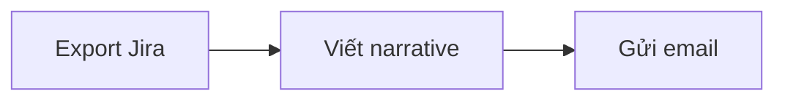

# Submission

## Loại bài

**Cá nhân + Nhóm.** Một phần làm cá nhân (CP1, CP2, CP7), một phần làm theo nhóm 3–4 người (CP3–CP6).

Dù có phần nhóm, **mỗi học viên tự tạo một repo cá nhân và tự nộp link trên LMS bằng tài khoản của mình**. Phần nhóm là một bản chung; nhóm hoàn thiện xong thì mỗi người copy vào repo của mình.

## Tên repo

### Repo đề bài

```text
K5-L3-DiscoveryProblemFraming
```

### Repo bài nộp (mỗi học viên một repo)

```text
K5-L3-DAY02-HoVaTen-MSSV-DiscoveryProblemFraming
```

Ví dụ: `K5-L3-DAY02-NguyenVanAn-20241234-DiscoveryProblemFraming`.

Quy tắc: viết không dấu, không khoảng trắng, các phần ngăn cách bằng dấu `-`, ngày học dùng hai chữ số (`DAY02`).

## Cấu trúc và file phải nộp

```text
K5-L3-DAY02-HoVaTen-MSSV-DiscoveryProblemFraming/
├── README.md, RULES.md, CHECKPOINTS.md, RUBRIC.md, SUBMISSION.md   ← giữ nguyên
├── TEAM.md                                  ← BẮT BUỘC: bản chung của nhóm
├── report/
│   ├── individual/
│   │   └── 20241234_NguyenVanAn.md          ← BẮT BUỘC: báo cáo cá nhân (đã đổi tên)
│   ├── team/
│   │   └── group_report.md                  ← BẮT BUỘC: bản chung của nhóm
│   └── assets/                              ← ảnh quy trình, Mermaid, ảnh survey, snapshot
├── docs/                                    ← giữ nguyên
└── src/                                     ← giữ nguyên (lab không có code)
```

### Phần cá nhân

- Đổi tên `report/individual/MSSV_HoTen.md` thành MSSV và họ tên không dấu, ví dụ `report/individual/20241234_NguyenVanAn.md`.
  - **Đúng:** `20241234_NguyenVanAn.md` (MSSV trước, dấu gạch dưới `_`, họ tên viết liền không dấu).
  - **Sai:** `MSSV_HoTen.md` (chưa đổi tên), `NguyenVanAn_20241234.md` (đảo thứ tự), `20241234-NguyenVanAn.md` (sai dấu nối).
  - Lưu ý: **tên repo** thì ngược lại, họ tên trước, MSSV sau, nối bằng `-`. Hai quy tắc này theo quy định đặt tên chung của chương trình.
- Điền đủ các mục 1–6 trong file đó.

### Phần nhóm

- `report/team/group_report.md`: nhóm làm chung một bản.
- `TEAM.md`: nhóm điền thông tin chung; **mỗi người tự điền phần cá nhân của mình**.
- Khi nhóm chốt bản cuối, mỗi thành viên copy **cả hai file** vào repo cá nhân. Nội dung hai file này phải giống nhau trong repo của mọi thành viên.

### File phụ

Đặt trong `report/assets/`, tên file bắt đầu bằng số checkpoint, ví dụ:

```text
report/assets/cp2-workflow-card-1.png
report/assets/cp4-interview-snapshot-1.md
report/assets/cp5-workflow-future.png
```

Dẫn link ảnh từ báo cáo, ví dụ ``.

**Sơ đồ Mermaid:** viết thẳng một khối code có nhãn `mermaid` trong báo cáo, GitHub sẽ tự hiển thị thành sơ đồ. Không lưu thành file `.mmd` rồi chèn bằng cú pháp ảnh ``, vì GitHub không hiển thị được kiểu đó.

````text

````

## Nơi nộp

Nộp **link repo GitHub** của bạn trên LMS, mục bài nộp Day 02. Repo để chế độ **public**, hoặc private và thêm coach làm collaborator theo hướng dẫn trên LMS.

## Deadline (GMT+7)

- Lab **sáng**: nộp trước **23h59 GMT+7** ngày lab.
- Lab **chiều/tối**: nộp trước **11h59 GMT+7** ngày hôm sau.
- Key coach có thể gia hạn tối đa 48 giờ nếu có lý do chính đáng. Thông báo gia hạn đăng trên LMS.
- Commit sau deadline (hoặc sau hạn gia hạn, nếu được gia hạn) không được chấm. Không có hình thức "nộp muộn bị trừ điểm".

## Checklist trước khi nộp

- [ ] Tên repo đúng mẫu `K5-L3-DAY02-HoVaTen-MSSV-DiscoveryProblemFraming`.
- [ ] Đã đổi tên báo cáo cá nhân từ `MSSV_HoTen.md` thành MSSV và họ tên của bạn (ví dụ `report/individual/20241234_NguyenVanAn.md`) và điền đủ mục 1–6.
- [ ] Bảng scan có ít nhất 5 problem dạng Job Story (CP1).
- [ ] Có 3 Problem Card và 3 quy trình nháp (CP2).
- [ ] Đã copy bản cuối `report/team/group_report.md` và `TEAM.md` của nhóm vào repo.
- [ ] Phần của bạn trong `TEAM.md` đã điền.
- [ ] Mọi ảnh và file phụ nằm trong `report/assets/` và hiển thị được khi mở báo cáo trên GitHub.
- [ ] Mọi link trong bảng research mở được.
- [ ] Không có thông tin cá nhân của người được phỏng vấn, API key hay file `.env`.
- [ ] Đã nộp link repo trên LMS trước deadline.
